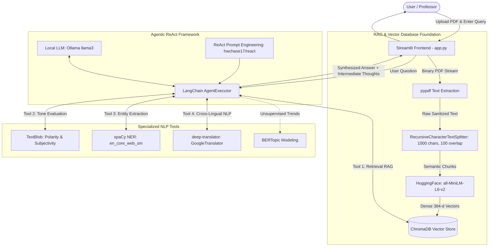

# Agentic RAG-Based AI Research Assistant
> **A Comprehensive NLP Capstone Project Powered by Local Ollama (LLaMA 3), ChromaDB & LangChain**

---

## 📌 Project Overview & Abstract

The **Agentic RAG-Based AI Research Assistant** is an offline, autonomous Natural Language Processing system engineered by a group of **2 students** for their college Capstone Project.

Academic researchers must continuously navigate thousands of dense, technical publications across diverse languages, evaluate scientific claims, and synthesize findings without succumbing to cognitive overload. While traditional Large Language Models (LLMs) can generate fluent text, they frequently **hallucinate** citations, lack domain fact-verification, and rely on external, paid cloud APIs.

To solve this, our system unites **Retrieval-Augmented Generation (RAG)**, **Vector Databases (ChromaDB)**, **ReAct Agents**, and **Custom NLP Tools** into a single, cohesive architecture powered by a **Local LLM (Ollama - LLaMA 3)**. The agent autonomously reasons over queries, retrieves exact passage excerpts from indexed academic papers, evaluates sentiment, extracts named entities, and translates cross-lingual queries—operating 100% offline with zero cloud API costs.

---

## 🎯 How the Project Hits the Professor's Mandatory Key Topics

| Mandatory Key Topic | Academic Role in Architecture | Implementation & Technology |
| :--- | :--- | :--- |
| **1. RAG (Retrieval-Augmented Generation)** | Eliminates factual hallucination by grounding generated responses in verified local document chunks. | LangChain Retriever + Chroma Vector Search + LLaMA 3 Context Synthesis |
| **2. Agents** | Autonomously reasons over user inquiries and decides *which* tool to invoke dynamically via the ReAct framework. | LangChain `create_react_agent` & `AgentExecutor` |
| **3. Tools** | Equips the agent with discrete NLP capabilities that extend beyond simple text generation. | `Document_Search` (RAG), `Sentiment_Analysis` (TextBlob), `Info_Extraction` (spaCy NER), `Translate` (deep-translator) |
| **4. Vector DB** | Stores dense continuous embeddings and performs sub-millisecond similarity search using HNSW indexing. | `ChromaDB` populated with `sentence-transformers/all-MiniLM-L6-v2` |
| **5. LLM (Local)** | Provides foundational natural language understanding and generative reasoning completely offline. | **Ollama** running **`llama3`** locally (no OpenAI / AWS API keys) |

---

## 🗺️ System Architecture



---

## 📚 Complete Syllabus & Course Outcome (CO) Mapping (Practicals 1 to 7)

This project provides end-to-end coverage of the university Natural Language Processing syllabus:

| Practical | Syllabus Topic | Course Outcome | Description & Implementation Details | Code Location |
| :---: | :--- | :---: | :--- | :--- |
| **Practical 1** | **Text Extraction & Preprocessing** | **CO1** | Ingestion of binary PDF streams using `pypdf`, whitespace normalization, and recursive chunking via `RecursiveCharacterTextSplitter` (chunk size: 1000, overlap: 100). | `Agentic_RAG_Project.ipynb`<br>`app.py` |
| **Practical 1** | **Vectorization & Vector DB** | **CO1** | Projection of textual chunks into 384-dimensional dense vectors using `sentence-transformers/all-MiniLM-L6-v2` and indexing inside `ChromaDB` for cosine similarity retrieval. | `Agentic_RAG_Project.ipynb`<br>`app.py` |
| **Practical 2** | **Sentiment & Subjectivity Analysis** | **CO2** | Lexical scoring of research claims using `TextBlob`, computing emotional polarity ($-1.0$ to $+1.0$) and empirical subjectivity ($0.0$ to $1.0$). | `Agentic_RAG_Project.ipynb`<br>`app.py` |
| **Practical 3** | **Information Extraction (NER)** | **CO2** | Token classification using `spaCy` (`en_core_web_sm`) to extract named entities including Persons (`PERSON`), Organizations (`ORG`), Dates (`DATE`), and Locations (`GPE`). | `Agentic_RAG_Project.ipynb`<br>`app.py` |
| **Practical 4** | **Unsupervised Topic Modeling** | **CO3** | Latent semantic theme discovery across multi-document academic corpora using `BERTopic` with HDBSCAN density clustering and c-TF-IDF keyword weighting. | `Agentic_RAG_Project.ipynb` |
| **Practical 5** | **Multilingual NLP** | **CO3** | Automated machine translation translating non-English inputs (French, Marathi, Hindi, Spanish) into English using `deep-translator`. | `Agentic_RAG_Project.ipynb`<br>`app.py` |
| **Practical 6** | **Agentic RAG & Multi-Tool Workflow** | **CO4** | Integration of specialized tools into LangChain `AgentExecutor` following the ReAct autonomous loop to solve multi-step research inquiries. | `Agentic_RAG_Project.ipynb`<br>`app.py` |
| **Practical 7** | **Generative AI & Prompt Engineering** | **CO4** | Calibration of the ReAct reasoning prompt (`hwchase17/react`) executed locally with `ChatOllama` (`llama3`), demonstrating zero-shot reasoning and tool invocation. | `Agentic_RAG_Project.ipynb`<br>`app.py` |

---

## 👥 Group Division of Labor (2 Students)

To ensure fair academic evaluation, the workload was systematically partitioned between both team members:

### 🎓 Student 1: NLP Backend, Vector Pipeline & Pedagogical Notebook
* **Focus Area:** Document parsing, semantic vector spaces, classical NLP models, and educational demonstration.
* **Assigned Deliverables:**
  1. Developed PDF text extraction using `pypdf` and recursive chunking using `RecursiveCharacterTextSplitter`.
  2. Built the dense vectorization pipeline using HuggingFace sentence-transformers and populated `ChromaDB`.
  3. Implemented sentiment and subjectivity scoring routines using `TextBlob`.
  4. Implemented Information Extraction and Named Entity Recognition (NER) using `spaCy` (`en_core_web_sm`).
  5. Built unsupervised topic modeling across multiple documents using `BERTopic`.
  6. Implemented cross-lingual machine translation functions using `deep-translator`.
  7. Authored the step-by-step pedagogical Jupyter Notebook (`Agentic_RAG_Project.ipynb`) detailing Practicals 1 through 7.

### 🎓 Student 2: Frontend Application, ReAct Agent, Ollama Integration & Testing
* **Focus Area:** Local LLM integration, ReAct agent reasoning, tool binding, and the interactive user interface.
* **Assigned Deliverables:**
  1. Configured local **Ollama** runtime and connected `ChatOllama` with the `llama3` model.
  2. Engineered LangChain `Tool` wrappers for document retrieval (`Document_Search`), sentiment analysis (`Sentiment_Analysis`), entity extraction (`Info_Extraction`), and machine translation (`Translate`).
  3. Engineered the ReAct prompt structure to prevent open-weights model hallucination and enforce structured `Thought -> Action -> Action Input -> Observation -> Final Answer` reasoning.
  4. Developed the complete Streamlit frontend (`app.py`) featuring document upload, progress tracking, and a **"Show Agent Thoughts"** toggle to visualize tool calling.
  5. Authored setup documentation (`setup_instructions.md`) and conducted system integration testing across edge cases.

---

## 📂 Project Repository Files

```text
├── setup_instructions.md       # Step-by-step environment, venv, and Ollama setup guide
├── requirements.txt            # Pinned Python package dependencies
├── Agentic_RAG_Project.ipynb   # 14-cell pedagogical Jupyter Notebook for viva & grading
├── app.py                      # Interactive Streamlit frontend web application
├── README.md                   # Comprehensive project documentation & syllabus mapping
└── sample_paper.pdf            # Sample academic paper for immediate evaluation
```

---

## 🚀 Step-by-Step Execution Guide

### 1. Environment Setup
Create and activate your Python virtual environment:

```powershell
# Windows
python -m venv venv
.\venv\Scripts\activate

# macOS / Linux
python3 -m venv venv
source venv/bin/activate
```

Install dependencies and download the spaCy language model:
```bash
pip install -r requirements.txt
python -m spacy download en_core_web_sm
```

### 2. Verify Local Ollama with LLaMA 3
Make sure the Ollama daemon is running, and pull the `llama3` model:
```bash
ollama pull llama3
```

### 3. Run the Pedagogical Jupyter Notebook (Viva Demonstration)
Launch Jupyter Notebook to evaluate each NLP practical sequentially:
```bash
jupyter notebook Agentic_RAG_Project.ipynb
```
Follow through Cells 1 to 14 to inspect text extraction, ChromaDB vectorization, TextBlob sentiment analysis, spaCy NER, BERTopic modeling, deep-translator multilingual NLP, and the full ReAct Agent execution trace.

### 4. Run the Streamlit Web Application (Live Demo)
Launch the interactive web interface:
```bash
streamlit run app.py
```
1. Open `http://localhost:8501` in your web browser.
2. Upload any academic research PDF (or use `sample_paper.pdf`) using the left sidebar.
3. Keep the **"Show Agent Thoughts"** toggle enabled.
4. Type questions in the chat box (e.g., *"What is the methodology proposed in this paper and what is its sentiment?"*) to watch the ReAct Agent reason and execute tools in real time.

---

## 📜 License
This capstone project is open-source under the MIT License for academic coursework and university evaluation.
